<div align="center">



<br/>

<sub>📍 HANOI, VN &nbsp;✳&nbsp; NO FIXED GENRE &nbsp;✳&nbsp; OCCASIONAL SLEEP</sub>

<br/><br/>

**[⟶ noblemode.id.vn ↗](https://noblemode.id.vn)** &nbsp;&nbsp;<sup>OR</sup>&nbsp;&nbsp; **[⟶ wander the projects ↗](https://github.com/NobleMode)**

<br/>

`╱╲` &nbsp; **GAMEPLAY SYSTEMS** &nbsp;───&nbsp; **NETWORKS** &nbsp;───&nbsp; **TOOLS** &nbsp; `╱╲`

</div>

<br/>

**A small dispatch from the workbench** &nbsp;↙

I build games, tools, and systems. Different rabbit holes; same fixation: make the complicated bit disappear for whoever has to use it. I am great at starting things and decent at finishing them.

> *Current conditions:* enemies getting smarter. Computers getting more obedient. The build is **probably** fine.
> <br/><sub>("probably" is doing a lot of work in that sentence.)</sub>

<br/>

<div align="center">

# ▀▄▀▄▀▄ &nbsp;THE PROJECTS&nbsp; ▄▀▄▀▄▀

<sub>currently making the most noise</sub>

</div>

<br/>

<table>
<tr>
<td width="150" align="center" valign="top"><h1>01</h1><sub>INPUT SHOULD<br/>FEEL INSTANT</sub></td>
<td valign="top">

### Remotier

Remote control for the “wait, is it frozen?” problem. The goal is for another computer to feel less *remote*: responsive input, low latency, no weird pause between thought and action.

**Under the hood** &nbsp;`C#` `C++` `.NET` `networking` `realtime input`

<sub>Yes, I have stared at a cursor for an hour to find 4 milliseconds. No, I don't regret it.</sub>

</td>
</tr>
</table>

<table>
<tr>
<td valign="top">

### <a href="https://github.com/NobleMode/frontal-assault">Frontal Assault ↗</a>

The waves keep coming. Resources keep shrinking. Your plan was good for about twelve seconds.

`GDScript` `GLSL ES` `combat systems` `enemy AI`

**FIGHT** → SCAVENGE → *REGRET* → REPEAT

<sub>I wrote the enemy AI. It now beats me at my own game. Growth.</sub>

</td>
<td width="150" align="center" valign="top"><h1>02</h1><sub>PVE SURVIVAL<br/>GODOT 4</sub></td>
</tr>
</table>

<table>
<tr>
<td width="150" align="center" valign="top"><h1>03</h1><sub>INVENTORY<br/>FULL. AGAIN.</sub></td>
<td valign="top">

### WunderKraft

An RPG-sim about loot, inventory Tetris, and weapon fusion. There is absolutely room for one more item. (There is not.)

**Unity 6** &nbsp;·&nbsp; `C#` `HLSL` &nbsp;·&nbsp; combat &amp; AI

<sub>Built a whole system to manage clutter, because my real-life clutter is unmanageable.</sub>

</td>
</tr>
</table>

<table>
<tr>
<td valign="top">

### StaLink

Files, keyboards, and clipboard thoughts travelling between devices. Making a pile of computers behave like one computer with a decent amount of emotional intelligence.

`JavaScript` `Python` `Mutagen` `Deskflow`

<sub>Copy on one computer, paste on another. Feels illegal. Isn't.</sub>

</td>
<td width="150" align="center" valign="top"><h1>04</h1><sub>DEVICES:<br/>PLEASE GET ALONG</sub></td>
</tr>
</table>

<br/>

<div align="center">

# ▀▄▀▄▀▄ &nbsp;PREVIOUSLY, IN THE OTHER TABS&nbsp; ▄▀▄▀▄▀

<sub>older stuff. still works. mostly.</sub>

</div>

```text
 ┌──────────────┬──────────────┬──────────────┬──────────────┬───┐
 │ POSitive   x │ Gesture..  x │ Wi-Fi Scan x │ Transport. x │ + │
 └──────────────┴──────────────┴──────────────┴──────────────┴───┘
   (4 tabs open · 0 closing · ram: crying)
```

| ▸ | tab | what it does | stack |
|:-:|:--|:--|:--|
| 🧾 | **[POSitive ↗](https://github.com/makecolour/POSitive)** | Cloud POS and e-invoice workflows. Checkout, with fewer plot twists. | `Laravel` `PHP` `MySQL` |
| 🖐️ | **[GestureTower ↗](https://github.com/NobleMode/leapMotion)** | A Unity game played with actual hand gestures. No mouse. Hands. | `Unity` `C#` `Leap Motion` |
| 📶 | **Android Wi-Fi Scanner** | Wi-Fi QR codes for devices that missed the quick-connect memo. | `Kotlin` `Android SDK` `ZXing` |
| 📨 | **Quick Text Transporter** | Sneak files and text between devices on the same network. | `C#` `LAN` |

<br/>

<div align="center">

# ▀▄▀▄▀▄ &nbsp;THE TOOL SHED&nbsp; ▄▀▄▀▄▀

*Everything is in its place. The place is “somewhere in here.”*

</div>

<table>
<tr>
<td width="130" align="center"><b>SHELF 1</b><br/>🗡️<br/><sub>sharp things</sub></td>
<td><b>LANGUAGES</b><br/><br/>
<table><tr>
<td align="center" width="96"><a href="https://learn.microsoft.com/dotnet/csharp/"></a><br/><sub><b>C#</b></sub></td>
<td align="center" width="96"><a href="https://isocpp.org"></a><br/><sub><b>C++</b></sub></td>
<td align="center" width="96"><a href="https://dev.java"></a><br/><sub><b>Java</b></sub></td>
<td align="center" width="96"><a href="https://www.python.org"></a><br/><sub><b>Python</b></sub></td>
<td align="center" width="96"><a href="https://developer.mozilla.org/docs/Web/JavaScript"></a><br/><sub><b>JavaScript</b></sub></td>
<td align="center" width="96"><a href="https://www.typescriptlang.org"></a><br/><sub><b>TypeScript</b></sub></td>
<td align="center" width="96"><a href="https://en.wikipedia.org/wiki/SQL"></a><br/><sub><b>SQL</b></sub></td>
</tr></table>
</td>
</tr>
<tr>
<td width="130" align="center"><b>SHELF 2</b><br/>🛠️<br/><sub>big machines</sub></td>
<td><b>ENGINES &amp; FRAMEWORKS</b><br/><br/>
<table><tr>
<td align="center" width="96"><a href="https://unity.com"></a><br/><sub><b>Unity</b></sub></td>
<td align="center" width="96"><a href="https://godotengine.org"></a><br/><sub><b>Godot</b></sub></td>
<td align="center" width="96"><a href="https://flaxengine.com"></a><br/><sub><b>Flax</b></sub></td>
<td align="center" width="96"><a href="https://spring.io/projects/spring-boot"></a><br/><sub><b>Spring Boot</b></sub></td>
<td align="center" width="96"><a href="https://dotnet.microsoft.com/apps/aspnet"></a><br/><sub><b>ASP.NET</b></sub></td>
<td align="center" width="96"><a href="https://nodejs.org"></a><br/><sub><b>Node.js</b></sub></td>
</tr></table>
</td>
</tr>
<tr>
<td width="130" align="center"><b>SHELF 3</b><br/>🧰<br/><sub>the plumbing</sub></td>
<td><b>SYSTEMS</b><br/><br/>
<table><tr>
<td align="center" width="96"><a href="https://www.postgresql.org"></a><br/><sub><b>PostgreSQL</b></sub></td>
<td align="center" width="96"><a href="https://www.mysql.com"></a><br/><sub><b>MySQL</b></sub></td>
<td align="center" width="96"><a href="https://en.wikipedia.org/wiki/REST"></a><br/><sub><b>REST</b></sub></td>
<td align="center" width="96"><a href="https://en.wikipedia.org/wiki/Network_socket"></a><br/><sub><b>sockets</b></sub></td>
<td align="center" width="96"><a href="https://kafka.apache.org"></a><br/><sub><b>Kafka</b></sub></td>
<td align="center" width="96"><a href="https://www.kernel.org"></a><br/><sub><b>Linux</b></sub></td>
<td align="center" width="96"><a href="https://www.docker.com"></a><br/><sub><b>Docker</b></sub></td>
</tr></table>
</td>
</tr>
</table>

<div align="center"><sub>▔▔▔▔▔▔▔▔▔▔▔▔▔▔▔▔▔▔▔▔▔▔▔▔▔▔▔▔▔▔▔▔▔▔▔▔▔▔▔▔▔▔▔▔▔▔▔▔▔▔▔▔▔▔▔▔▔▔▔▔▔▔▔▔▔▔▔▔▔▔▔▔▔▔▔▔▔▔▔▔▔▔▔▔▔▔▔▔▔▔▔▔▔▔▔▔▔▔</sub></div>

<details>
<summary><sup><b>THE BORING-ON-PURPOSE BIT &nbsp;↓</b></sup> &nbsp;<sub>(the grown-up stuff, in snack size)</sub></summary>

<br/>

<div align="center">

**💼 WORK**<br/>


**🎓 STUDY**<br/>


**🏆 TINY PODIUM TOUR**<br/>


**📎 EXTRA STATS**<br/>


</div>

<br/>

```diff
  2023  ▸ KIS Vietnam · Chillin Studio · FPT University (day one)
+ 2024  ▸ IEC Games · 4th, Algorithm Arena 5.0
+ 2025  ▸ POSitive / HubSportWeb
! 2026  ▸ 2nd, Coding Inspiration · graduated (survived)
- NOW   ▸ still opening new tabs
```

</details>

<br/>

<div align="center">

✳ &nbsp;&nbsp; so, what are you making? &nbsp;&nbsp; ✳

**[send me down a new rabbit hole ↗](https://noblemode.id.vn)**

</div>
